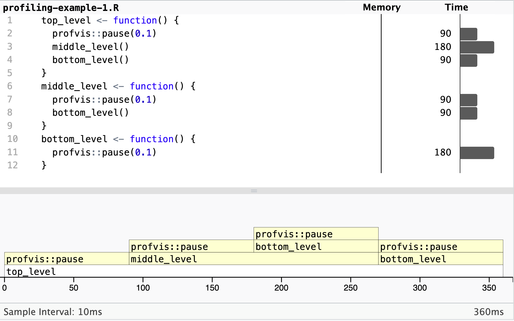
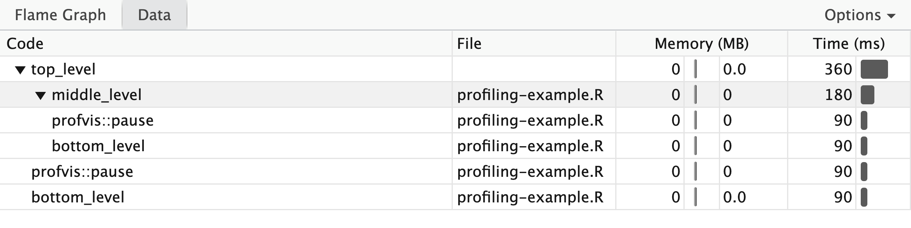
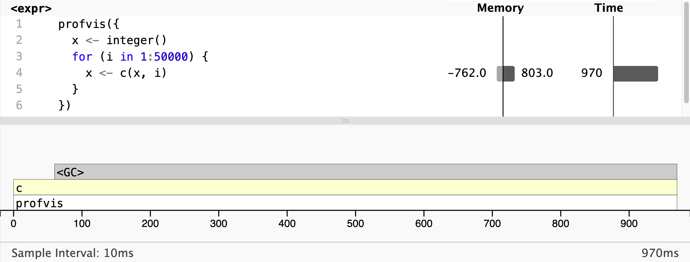

## Course website

<p class="big">[bham-carpentries.github.io/pando-r](https://bham-carpentries.github.io/pando-r/)</p>

- All the material is there: follow along, catch up, revisit later
- The code is live-coded (not shown on these slides): type along with me

## Why optimise?

- Get results faster
- Scale up to bigger analyses
- Lower costs (cloud, HPC)
- Lower energy use

. . .

<p class="big">But first: find out *where* the time goes</p>

## Today you will learn to

- **Profile**: find the slow parts with **profvis**
- **Benchmark**: compare alternatives with **bench**
- **Recognise**: spot coding patterns that are known to be slow
- **Rewrite**: speed up a bottleneck without changing its output

## Setup check

```r
install.packages(
  c("profvis", "bench", "tinytest", "futurize", "tictoc")
)

install.packages(
  c("ggplot2", "ggbeeswarm", "tidyr", "future.apply")
)

install.packages("remotes")
remotes::install_github("csgillespie/efficient",
                        INSTALL_opts = "--with-keep.source")
```

<p class="muted">Full instructions: [Setup](https://bham-carpentries.github.io/pando-r/index.html#software-setup)</p>

<!-- ======================================================================= -->

# Introduction to profiling {background-color="#1a4f8b"}

[Episode page](https://bham-carpentries.github.io/pando-r/profiling-introduction.html){.episode-link}

## What is profiling?

Measuring how your code uses resources as it runs:

- **Time**: how long does it take?
- **Memory**: how much RAM does it need?

. . .

<p class="big">Aim for *fast enough*,<br>not *as fast as possible*</p>

## When to profile

- Once the code **works** (gives correct results)
- If it will run for more than a few minutes over its lifetime

## Everyone can benefit

**GTA Online**: slow loading screens for 8 years

An outsider profiled it → **70% faster** loading

<p class="muted">[How I cut GTA Online loading times by 70%](https://nee.lv/2021/02/28/How-I-cut-GTA-Online-loading-times-by-70/)</p>

::: notes
Naively parsed a 10MB JSON file: repeatedly computing string lengths (fixed by caching), and a linear search for duplicates before every insert (fixed by using a dictionary). Allegedly there were never any duplicates.
:::

## Types of profiling

- **Manual**: add timers around sections of code
- **Function-level**: how long in each function?
- **Line-level**: how long on each line?

. . .

In R, **profvis** does function- *and* line-level profiling, *and* visualises it

## Choosing a test case

Profiling slows your code down and generates lots of data

A good test case is:

- **Representative** of real use
- **Quick**: minutes, not hours
- **Big enough** to show the bottlenecks

<p class="muted">e.g. a year-long hourly model → profile one day</p>

## Plan your profiling {.discussion}



Think of an R project you've worked on.

- Do you know where the time is spent?
- How would you find out?
- What would be a good test case?

<!-- ======================================================================= -->

# Profiling with profvis {background-color="#1a4f8b"}

[Episode page](https://bham-carpentries.github.io/pando-r/profiling-profvis.html){.episode-link}

## How profvis works

A **sampling profiler**: every few milliseconds it pauses and records

- The **call stack**: which function is running, and what called it
- **Memory** allocated and released

<p class="muted">Results vary a little each run</p>

## Call stack {.exercise}



:::: {.columns}
::: {.column width="50%"}
```r
top_level <- function() {
  profvis::pause(0.1)
  middle_level()
  bottom_level()
}
middle_level <- function() {
  profvis::pause(0.1)
  bottom_level()
}
bottom_level <- function() {
  profvis::pause(0.1)
}
```
:::
::: {.column width="50%"}
After 0.1s:<br>`pause`, `top_level`

After 0.2s:<br>`pause`, `middle_level`, `top_level`

What is the call stack after **0.3s**? After **0.4s**?
:::
::::

## Follow along

1. Create an RStudio project
2. Download [profiling-example-1.R](https://bham-carpentries.github.io/pando-r/files/profiling-example-1.R) into it
3. Create `profiling.R`:

```r
library(profvis)
source("profiling-example-1.R")
profvis(top_level())
```

<p class="muted">Use RStudio, not Positron, for profiling</p>

## The flame graph

{fig-alt="profvis output: source code with time bars at the top, flame graph of nested function calls along a time axis at the bottom."}

## The data tab

{fig-alt="profvis data tab: a table of function calls with columns for code, file, memory (MB) and time (ms)."}

## Memory profiling

{fig-alt="profvis output for a loop that grows a vector with c(), showing large memory allocation and time in <GC>."}

`<GC>` = garbage collector

## Monopoly {.exercise}



```r
library(efficient)
profvis(simulate_monopoly(10000))
```

Which parts of the code are slow?

## Travelling salesperson {.exercise}



Download [travelling-salesperson.R](https://bham-carpentries.github.io/pando-r/files/travelling-salesperson.R)

```r
profvis(travelling_salesperson(n_cities))
```

- Where is most of the time spent?
- Which parts use lots of memory?
- What value of `n_cities` makes a good test case?

<p class="muted">Too slow? Press <kbd>Esc</kbd> or the red stop button</p>

<!-- ======================================================================= -->

# Microbenchmarking {background-color="#1a4f8b"}

[Episode page](https://bham-carpentries.github.io/pando-r/microbenchmarking.html){.episode-link}

## Small times add up

| If one call takes | then in one second you can make |
|---|---|
| 1 millisecond (ms) | 1 thousand calls |
| 1 microsecond (µs) | 1 million calls |
| 1 nanosecond (ns) | 1 billion calls |

## `bench::mark()`

- Runs each expression many times
- Checks they all give the **same result**
- Reports **time** and **memory**

## Useful columns {.discussion}

`min` · `median` · `itr/sec` · `mem_alloc` · `n_gc` · `gc/sec` · `n_itr` · `total_time`

Which are most useful for picking the best expression? Why?

## Square roots {.exercise}



How will these rank on speed? Check with `bench::mark()`.

```r
sqrt(x)
x ^ 0.5
x ^ (1/2)
exp(log(x) / 2)
```

## Benchmarking more than one line

Wrap each version in a function:

```r
fun1 <- function() {
  # some code
}

fun2 <- function() {
  # some other code
}

bench::mark(fun1(), fun2())
```

## `bench::press()`

What does "big" mean for your data?

- More rows, or more columns?
- More observations, or more groups?

`bench::press()` benchmarks over a **grid of parameters**

## `gl()` {.exercise}



`gl(n, k)`: a factor with `n` levels, each repeated `k` times

```r
gl(2, 3)
#> [1] 1 1 1 2 2 2
#> Levels: 1 2
```

Looking at `bp`, does increasing `n` or `k` have the bigger impact on speed?

<!-- ======================================================================= -->

# Introduction to optimisation {background-color="#1a4f8b"}

[Episode page](https://bham-carpentries.github.io/pando-r/optimisation-introduction.html){.episode-link}

## Premature optimisation

> We should forget about small efficiencies, say about 97% of the time: **premature optimization is the root of all evil**. Yet we should not pass up our opportunities in that critical 3%.
>
> — Donald Knuth

## Performance vs maintainability

- Faster code can be harder to read
- Use profiling to **prioritise**
- Good data structures and algorithms from the start
- Don't micro-optimise everything

## Why is R "slow"?

:::: {.columns}
::: {.column width="50%"}
**C**

```c
int a = 1;
```

- Raw data
- Compiled to machine code
- 4 bytes
:::
::: {.column width="50%"}
**R**

```r
a <- 1L
```

- Everything is an object
- Interpreted
- 56 bytes
:::
::::

## R is built on compiled code

Much of R (and packages like **dplyr** and **data.table**) is written in C, C++ or Fortran

. . .

<p class="big">Tell R *what* you want,<br>let it work out *how*</p>

## Test before you optimise

- Optimising means speculative changes → easy to introduce bugs
- Write tests **first**, re-run them after **every** change

. . .

- **testthat**: for packages
- **tinytest**: lightweight, works in scripts too

## `expect_*()` {.exercise}



```r
is_bigger <- function(a, b) {
  a > b
}

greeting <- function(name) {
  stopifnot(is.character(name))
  paste("Hello", name)
}

expect_*(is_bigger(6, 3))
expect_*(greeting(6))
expect_*(greeting("Ella"), "Hello Ella")
```

Which `expect_*()` functions make these tests pass?

<!-- ======================================================================= -->

# Base R optimisations {background-color="#1a4f8b"}

[Episode page](https://bham-carpentries.github.io/pando-r/optimisation-base-r.html){.episode-link}

## The golden rule

<p class="big">Get to the underlying C code<br>as quickly as possible</p>

Fewer R function calls → less overhead

## Counting function calls {.discussion}

```r
x <- x + 1
```

vs

```r
for (i in seq_along(x)) {
  x[i] <- x[i] + 1
}
```

How many function calls does the loop make?

## Loop vs vector {.exercise}



Use `bench::mark()` to compare `x <- x + 1` with the `for` loop.

Try different lengths of `x`.

<p class="muted">Tip: wrap each version in a function</p>

## Vectorisation

Work on whole vectors, not individual elements

- Simpler to think about
- Loops run in C, not R
- Shorter, more readable code

## Variance {.exercise}



Write a vectorised `variance()` function:

$$
\mathrm{Var}(x) = \frac{1}{n-1}\sum_{i=1}^n(x_i - \bar{x})^2
$$

Benchmark it against `var()` with `x <- runif(10000)`.

Why is `var()` faster?

## Logical operators

- `&` and `|`: vectorised, element by element
- `&&` and `||`: length-1 only, skip the right-hand side if not needed

<p class="muted">`&&` / `||` on longer vectors is an error in R ≥ 4.3</p>

## The `apply()` family

| Function | Applies over | Returns |
|---|---|---|
| `apply()` | rows/columns of a matrix | vector, matrix or list |
| `lapply()` | elements of a list/vector | list |
| `sapply()` | elements of a list/vector | simplified (if possible) |
| `vapply()` | elements of a list/vector | type you specify: safer, faster |

## Faster specialised options

For numeric matrices and data frames, specialised functions are faster than `apply()`

- `rowSums(mat)` (instead of `apply(mat, 1, sum)`)
- `colSums()`
- `rowMeans()`
- `colMeans()`

## Faster common operations

| Instead of | Use |
|---|---|
| `sort(x)[1:10]` | `sort(x, partial = 1:10)[1:10]` |
| `rev(sort(x))` | `sort(x, decreasing = TRUE)` |
| `seq()` | `seq_len()`, `seq_along()`, `seq.int()` |
| `rep()` | `rep.int()`, `rep_len()` |
| `which(x == min(x))` | `which.min(x)` |
| `any(is.na(x))` | `anyNA(x)` |

<p class="muted">Check the help pages!</p>

<!-- ======================================================================= -->

# Memory management {background-color="#1a4f8b"}

[Episode page](https://bham-carpentries.github.io/pando-r/memory-management.html){.episode-link}

## Names point to objects

```r
x <- c(1, 2, 3)
y <- x
```

One object, two names: **no copy**

## Copy-on-modify

R copies an object only when you **modify** one that has **more than one name**

- Passing to a function doesn't copy
- Copies cost time and memory, especially in loops
- `tracemem()` shows you when copies happen

<p class="muted">RStudio's Environment pane can cause extra copies</p>

## Avoid unnecessary objects

- Reuse names: `x <- x + 1`
- Don't save intermediate results you don't need
- `rm()` large objects you're finished with
- Cache variables: compute once, then reuse

## Use the simplest data structure

- Matrix rather than data frame (if all one type)
- Integer or logical rather than double
- Unnamed rather than named

## Don't grow objects

`c()`, `append()`, `rbind()`, `cbind()`, `paste()` in a loop:

- New object allocated every iteration
- Old one copied into it
- Total work grows with the **square** of the length

## Growing vectors {.exercise}



`grow(n)` · `pre_allocate(n)` · `direct(n)`

- Which do you expect to be fastest? Why?
- Which will scale best as `n` increases? Worst?
- Check with `bench::mark()`. At what `n` do differences appear?

## Monopoly revisited {.exercise}



1. Copy `View(move_square)` into `move_square2()`, speed it up
2. Benchmark with this, then compare `profvis()` for both:

```r
run <- function(n, fun) {
  x <- numeric(n)
  for (i in seq_len(n)) {
    set.seed(i)
    x[i] <- fun(1)
  }
  x
}
n <- 1000
bench::mark(run(n, move_square), run(n, move_square2))
```

<!-- ======================================================================= -->

# Data frames {background-color="#1a4f8b"}

[Episode page](https://bham-carpentries.github.io/pando-r/optimisation-data-frames.html){.episode-link}

## Three ways to hold a table

- `data.frame`: base R
- `tbl_df` (tibble): tidyverse
- `data.table`: built for speed on large data

. . .

All three are **lists of columns**

## Converting between them

| | Copies data? |
|---|---|
| `as_tibble(df)` | No |
| `as.data.table(df)` | **Yes** |
| `setDT(df)` | No: converts in place |

## Two ways to modify

- `data.frame`, `tibble`: **copy-on-modify**<br>changing one value copies that whole column
- `data.table`: **modify-by-reference** with `:=` and `set()`<br>no copy

## By-reference changes are visible everywhere

```r
a <- data.table(x = 1:3)
b <- a
b[, x := 0L]
a$x
#> [1] 0 0 0
```

Use `copy()` if you need an independent table

## Modifying in a loop

<p class="big">Slow for every table type</p>

1. Avoid modifying tables element by element in loops
2. If you must loop, work on a plain vector, write back once
3. Better still: vectorise

## Speed up a loop {.exercise}



```r
flag_high <- function(d, threshold = 0.9) {
  d$high <- FALSE
  for (i in seq_len(nrow(d))) {
    if (d$value[i] > threshold) d[i, "high"] <- TRUE
  }
  d
}

small_df <- df[1:10000, ]
small_tb <- tb[1:10000, ]
```

Write a version with no loop. How much faster is it? How much less memory?

## Reading files

`read.csv()` → `readr::read_csv()` → `data.table::fread()`

<p class="muted">slow → fast → fastest</p>

. . .

`data.table` is multithreaded: `getDTthreads()`

## Benchmarking fairly

1. Results may not be identical: check separately
2. By-reference code changes the input
3. Repeated runs can get faster (indexes)
4. `mem_alloc` misses memory allocated in C
5. Size matters: benchmark at realistic scale

## Choosing a data structure

- **Small/medium data**: whatever is clearest to you
- **Large data, or repeated runs**: profile first; `data.table` for grouping, joins, sorting, reading
- **Tight memory**: `data.table` or avoid copying large columns
- **Mix and match**: converting is cheap

::: {.callout-tip}
## **dtplyr**
Write dplyr, run data.table
:::

## Your own work {.discussion}

- How big is your data? Which operations are slowest?
- Would changing the data structure help, or changing *how* you use it?
- What would switching cost you?

<!-- ======================================================================= -->

# Parallel computing {background-color="#1a4f8b"}

[Episode page](https://bham-carpentries.github.io/pando-r/optimisation-parallel.html){.episode-link}

## Parallel computing

- Split a task across several CPU cores
- R uses **one** core by default

. . .

**Embarrassingly parallel**: independent pieces, combined at the end

. . .

But parallelism has **overheads**

## **futurize**

```r
library(futurize)
plan(multisession)                        # once, at the top

ys <- lapply(xs, slow_fcn)                # sequential
ys <- lapply(xs, slow_fcn) |> futurize()  # parallel
```

<p class="muted">Works with the `apply()` family, **purrr**, **foreach**, ... and on HPC</p>

## Snakes and ladders {.exercise}



Parallelise this, and compare run times with **tictoc**:

```r
library(efficient)
N <- 100
nrolls <- sapply(seq_len(N), snakes_ladders)
```

How large does `N` need to be for parallel to be worth it?

<!-- ======================================================================= -->

# Good software engineering practices {background-color="#1a4f8b"}

[Episode page](https://bham-carpentries.github.io/pando-r/software-engineering.html){.episode-link}

## Keep R up to date

- **R 3.4.0**: just-in-time byte-code compiler
- **R 3.5.0**: ALTREP: `1:1e9` uses almost no memory

## Keep packages up to date

- **dplyr 1.2.0**: `if_else()`, `case_when()` up to 30x faster
- **dplyr 1.1.0**: `arrange()` up to 100x faster
- **readr 2.0.0**: multithreaded reading

. . .

Check the release notes: behaviour can change too

## Look for existing solutions

- [CRAN Task Views](https://cran.r-project.org/web/views/), especially [High-Performance Computing](https://cran.r-project.org/web/views/HighPerformanceComputing.html)
- Packages using **Rcpp** or **cpp11** are likely to be fast

## Faster linear algebra: BLAS

`%*%`, `solve()`, `lm()` and more use BLAS

```r
sessionInfo()   # see the "BLAS:" line
```

. . .

<p class="big">1.82s → 0.038s</p>

<p class="muted">2000 × 2000 matrix multiplication, reference BLAS vs Apple Accelerate</p>

. . .

Only helps linear algebra · may clash with parallel code

<!-- ======================================================================= -->

# Next steps {background-color="#1a4f8b"}

[Episode page](https://bham-carpentries.github.io/pando-r/next-steps.html){.episode-link}

## Learn more

- [Advanced R](https://adv-r.hadley.nz): Hadley Wickham
- [Efficient R Programming](https://csgillespie.github.io/efficientR/): Colin Gillespie & Robin Lovelace

## Still too slow?

Rewrite the bottleneck in a compiled language, call it from R

- **C++** with [**Rcpp**](https://www.rcpp.org): mature, widely used
- **Rust** with [**rextendr**](https://extendr.rs/rextendr/): newer, memory-safe

## Summary

1. **Profile** to find the bottleneck
2. **Test** so you know the results stay correct
3. **Optimise**: vectorise, don't grow, simple data structures
4. **Benchmark** to check it's actually faster

. . .

<p class="big">[bham-carpentries.github.io/pando-r](https://bham-carpentries.github.io/pando-r/)</p>
